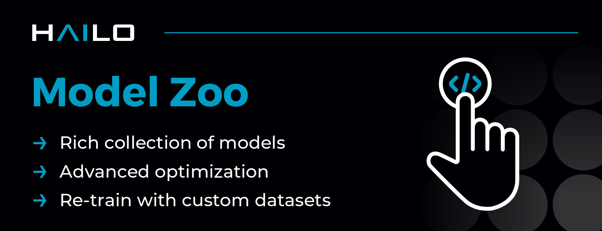
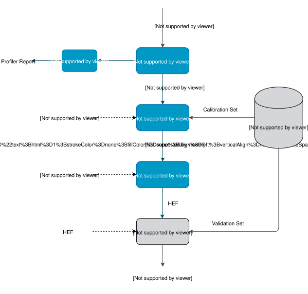

Hailo Model Zoo
===============

.. |python| image:: https://img.shields.io/badge/python-3.10%20%7C%203.11%20%7C%203.12-blue.svg
   :target: https://www.python.org/downloads/release/python-3123/
   :alt: Python 3.12
   :width: 150
   :height: 20

.. |tensorflow| image:: https://img.shields.io/badge/Tensorflow-2.18.0-blue.svg
   :target: https://github.com/tensorflow/tensorflow/releases/tag/v2.18.0
   :alt: Tensorflow
   :width: 110
   :height: 20

.. |cuda| image:: https://img.shields.io/badge/CUDA-12.5.1-blue.svg
   :target: https://developer.nvidia.com/cuda-toolkit
   :alt: Cuda
   :width: 80
   :height: 20

.. |compiler| image:: https://img.shields.io/badge/Hailo%20Dataflow%20Compiler-3.34.0-brightgreen.svg
   :target: https://hailo.ai/company-overview/contact-us/
   :alt: Hailo Dataflow Compiler
   :width: 180
   :height: 20

.. |runtime| image:: https://img.shields.io/badge/HailoRT%20(optional)-4.24.0-brightgreen.svg
   :target: https://hailo.ai/company-overview/contact-us/
   :alt: HailoRT
   :width: 170
   :height: 20

.. |license| image:: https://img.shields.io/badge/License-MIT-yellow.svg
   :target: https://github.com/hailo-ai/hailo_model_zoo/blob/master/LICENSE
   :alt: License: MIT
   :width: 80
   :height: 20

|python| |tensorflow| |cuda| |compiler| |runtime| |license|

The Hailo Model Zoo provides pre-trained models for high-performance deep learning applications. Using the Hailo Model Zoo you can measure the full precision accuracy of each model, the quantized accuracy using the Hailo Emulator and measure the accuracy on the Hailo-8 device. Finally, you will be able to generate the Hailo Executable Format (HEF) binary file to speed-up development and generate high quality applications accelerated with Hailo-8. The Hailo Model Zoo also provides re-training instructions to train the models on custom datasets and models that were trained for specific use-cases on internal datasets.

Models
Hailo provides different pre-trained models in ONNX / TF formats and pre-compiled HEF (Hailo Executable Format) binary file to execute on the Hailo devices.

The models are divided to:

* Public models - which were trained on publicly available datasets.

    * For Hailo-8 - `Classification <docs/public_models/HAILO8/HAILO8_classification.rst>`_, `Object Detection <docs/public_models/HAILO8/HAILO8_object_detection.rst>`_, `Segmentation <docs/public_models/HAILO8/HAILO8_semantic_segmentation.rst>`_, `other tasks <docs/PUBLIC_MODELS.rst>`_

    * For Hailo-8L - `Classification <docs/public_models/HAILO8L/HAILO8L_classification.rst>`_, `Object Detection <docs/public_models/HAILO8L/HAILO8L_object_detection.rst>`_, `Segmentation <docs/public_models/HAILO8L/HAILO8L_semantic_segmentation.rst>`_, `other tasks <docs/PUBLIC_MODELS.rst>`_

* | `HAILO MODELS <docs/HAILO_MODELS.rst>`_ which were trained in-house for specific use-cases on internal datasets.
  | Each Hailo Model is accompanied with retraining instructions.

What's new
----------

**Models-only update** v2.20.0 adds new models on top of v2.19.0. The software stack is unchanged: Dataflow Compiler v3.34.0 and HailoRT v4.24.0 (see `Changelog <docs/CHANGELOG.rst>`_).

**New model support** We have expanded the Model Zoo with new tasks and architectures for image captioning, oriented object detection, OCR, semantic segmentation, super resolution, audio classification, age/gender estimation and single- and multi-object tracking:

* `ViT-GPT2 <https://huggingface.co/nlpconnect/vit-gpt2-image-captioning>`_ - Image captioning models - vit_gpt2_encoder, vit_gpt2_decoder
* `YOLOv11-obb <https://arxiv.org/pdf/2410.17725v1>`_ - Oriented bounding box detection models (DOTA v1) - yolov11n_obb, yolov11s_obb, yolov11m_obb, yolov11l_obb, yolov11x_obb
* `PaddleOCR-v6 <https://www.paddleocr.ai/main/en/version3.x/algorithm/PP-OCRv6/PP-OCRv6.html>`_ - Text detection and recognition models - paddle_ocr_v6_tiny_detection, paddle_ocr_v6_small_detection, paddle_ocr_v6_medium_detection, paddle_ocr_v6_small_recognition
* `YOLO26-sem <https://docs.ultralytics.com/tasks/semantic/>`_ - Cityscapes semantic segmentation models - yolo26n_sem, yolo26s_sem, yolo26m_sem (Hailo-8 only)
* `YOLO26-seg <https://arxiv.org/abs/2509.25164>`_ - yolo26s_seg - Added to the NMS-free instance segmentation family
* `YamNet <https://github.com/tensorflow/models/tree/master/research/audioset/yamnet>`_ - yamnet - AudioSet audio event classification, the first audio network in the Model Zoo
* `MiVOLO <https://github.com/WildChlamydia/MiVOLO>`_ - mivolo_d1 - Age and gender estimation (Hailo-8 only)
* `BiSeNetV2 <https://github.com/CoinCheung/BiSeNet>`_ - bisenetv2 - Real-time Cityscapes semantic segmentation
* `STARK-Lightning <https://arxiv.org/abs/2103.17154>`_ - stark_lightning_repvgg_a0 - Single-object tracker
* `ByteTrack <https://github.com/ifzhang/ByteTrack>`_ - Multi-object tracking (MOT17) - bytetrack_nano_mot17, bytetrack_tiny_mot17, bytetrack_s_mot17, bytetrack_m_mot17, bytetrack_l_mot17, bytetrack_x_mot17
* `DDRNet <https://github.com/ydhongHIT/DDRNet>`_ - ddrnet_23_slim - Real-time Cityscapes semantic segmentation
* `PP-LiteSeg <https://arxiv.org/abs/2204.02681>`_ - pp_liteseg_t, pp_liteseg_b - Real-time Cityscapes semantic segmentation
* `SPAN <https://github.com/hongyuanyu/SPAN>`_ - span_x2, span_x4 - New super-resolution models (NTIRE 2024 Efficient Super-Resolution winner)
* `SPANF <https://github.com/Amazingren/NTIRE2025_ESR>`_ - spanf_x4 - New super-resolution model, a lighter successor of SPAN

Retraining
----------

Hailo also provides `RETRAINING INSTRUCTIONS <docs/RETRAIN_ON_CUSTOM_DATASET.rst>`_ to train a network from the Hailo Model Zoo with custom dataset.

Benchmarks
----------

| List of Hailo's benchmarks can be found in `hailo.ai <https://hailo.ai/developer-zone/benchmarks/>`_.
| In order to reproduce the measurements please refer to the following `page <docs/BENCHMARKS.rst>`_.

Quick Start Guide
------------------

* Install Hailo Dataflow Compiler and enter the virtualenv. In case you are not Hailo customer please contact `hailo.ai <https://hailo.ai/company-overview/contact-us/>`_
* Install HailoRT (optional). Required only if you want to run on Hailo-8. In case you are not Hailo customer please contact `hailo.ai <https://hailo.ai/company-overview/contact-us/>`_
* Clone the Hailo Model Zoo

  .. code-block::

      git clone https://github.com/hailo-ai/hailo_model_zoo.git

* Run the setup script

  .. code-block::

     cd hailo_model_zoo; pip install -e .

* Run the Hailo Model Zoo. For example, print the information of the MobileNet-v1 model:

  .. code-block::

     hailomz info mobilenet_v1

Getting Started
^^^^^^^^^^^^^^^

For full functionality please see the `INSTALLATION GUIDE <docs/GETTING_STARTED.rst>`_ page (full install instructions and usage examples). The Hailo Model Zoo is using the Hailo Dataflow Compiler for parsing, model optimization, emulation and compilation of the deep learning models. Full functionality includes:

* | Parse: model translation of the input model into Hailo's internal representation.
* | Profiler: generate profiler report of the model. The report contains information about your model and expected performance on the Hailo hardware.
* | Optimize: optimize the deep learning model for inference and generate a numeric translation of the input model into a compressed integer representation.
  | For further information please see our `OPTIMIZATION <docs/OPTIMIZATION.rst>`_ page.
* | Compile: run the Hailo compiler to generate the Hailo Executable Format file (HEF) which can be executed on the Hailo hardware.
* | Evaluate: infer the model using the Hailo Emulator or the Hailo hardware and produce the model accuracy.

For further information about the Hailo Dataflow Compiler please contact `hailo.ai <https://hailo.ai/company-overview/contact-us/>`_.

License
-------

The Hailo Model Zoo is released under the MIT license. Please see the `LICENSE <https://github.com/hailo-ai/hailo_model_zoo/blob/master/LICENSE>`_ file for more information.

Support & Issues
----------------

⚠️ **Issue reporting is disabled in this repository.**

For bug reports, feature requests, or discussions, please visit our `Hailo Community Forum <https://community.hailo.ai/>`_.

Changelog
---------

For further information please see our `CHANGELOG <docs/CHANGELOG.rst>`_ page.
