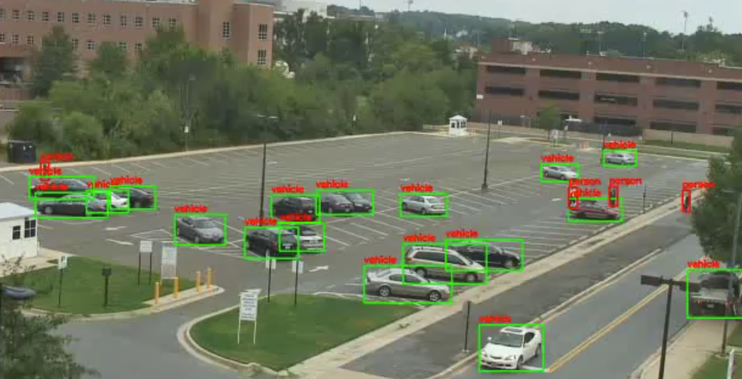

=====================
Multi-Class Detection
=====================

Hailo's multi-class detection networks (\ *hailo_yolov8n / hailo_yolov8s / hailo_yolov8m*\ ) are based on YOLOv8 and were trained in-house on four classes — **person**, **vehicle**, **face** and **license plate**. A single network covers the classes that are otherwise split across the person-face, vehicle and license-plate detectors, which makes it a good fit for smart-city and video-analytics pipelines that need all four in one pass.

Six variants are provided: three model sizes at two input resolutions each, so you can trade accuracy against throughput without changing the pipeline. Compiled HEFs are available for **Hailo-15H**, **Hailo-15L** and **Hailo-10H**.

**These models are released as pre-compiled HEFs only.** The ONNX and the retraining flow are not published — see `Download`_ below.

Model Details
-------------

Architecture
^^^^^^^^^^^^

* | YOLOv8 (nano / small / medium), 4 detection classes
* | Anchor-free decoupled head, DFL box regression (regression length 16), three strides (8/16/32)

.. list-table::
   :header-rows: 1

   * - Network Name
     - Input Resolution (HxWxC)
     - Params (M)
     - GMACs
   * - hailo_yolov8n_384_640
     - 384x640x3
     - 3.0
     - 2.4
   * - hailo_yolov8n_480_640
     - 480x640x3
     - 3.0
     - 3.0
   * - hailo_yolov8s_384_640
     - 384x640x3
     - 11.13
     - 8.5
   * - hailo_yolov8s_480_640
     - 480x640x3
     - 11.13
     - 10.65
   * - hailo_yolov8m_384_640
     - 384x640x3
     - 25.9
     - 23.6
   * - hailo_yolov8m_480_640
     - 480x640x3
     - 25.9
     - 29.5

Inputs
^^^^^^

* | Single input, ``UINT8`` ``NHWC`` — raw RGB at the network's input resolution (384x640x3 or 480x640x3)
* | Image normalization occurs on-chip, so no host-side scaling is required

Outputs
^^^^^^^

* | Single output, ``FLOAT32`` — ``HAILO NMS BY CLASS``
* | The YOLOv8 box decode and NMS are embedded in the HEF and applied by HailoRT, so you read **decoded detections** directly. There are no raw detection heads to decode yourself.

  * | Classes: 4 — index 0 ``person``, 1 ``vehicle``, 2 ``face``, 3 ``license_plate``
    | Maximum bounding boxes per class: 100
    | Score threshold: 0.2, IoU threshold: 0.6

* | Each detection holds 5 values: 4 normalized box coordinates plus a confidence score.

----

Accuracy and Performance
^^^^^^^^^^^^^^^^^^^^^^^^

Hailo-15H and Hailo-10H share the same compiled HEF and therefore the same accuracy; only throughput differs.

.. list-table:: Hailo-15H
   :header-rows: 1

   * - Network Name
     - Full Precision mAP*
     - Quantized mAP*
     - FPS (batch 1)
     - FPS (batch 8)
     - Contexts
   * - hailo_yolov8n_384_640
     - 44.4
     - 43.8
     - 444
     - 1192
     - 2
   * - hailo_yolov8n_480_640
     - 47.8
     - 47.0
     - 415
     - 1035
     - 2
   * - hailo_yolov8s_384_640
     - 50.8
     - 49.8
     - 202
     - 477
     - 3
   * - hailo_yolov8s_480_640
     - 53.4
     - 52.4
     - 186
     - 400
     - 3
   * - hailo_yolov8m_384_640
     - 53.9
     - 53.0
     - 100
     - 210
     - 5
   * - hailo_yolov8m_480_640
     - 56.2
     - 55.7
     - 91.9
     - 174
     - 5

.. list-table:: Hailo-10H
   :header-rows: 1

   * - Network Name
     - Full Precision mAP*
     - Quantized mAP*
     - FPS (batch 1)
     - FPS (batch 8)
     - Contexts
   * - hailo_yolov8n_384_640
     - 44.4
     - 43.8
     - 438
     - 550
     - 2
   * - hailo_yolov8n_480_640
     - 47.8
     - 47.0
     - 411
     - 517
     - 2
   * - hailo_yolov8s_384_640
     - 50.8
     - 49.8
     - 199
     - 374
     - 3
   * - hailo_yolov8s_480_640
     - 53.4
     - 52.4
     - 184
     - 337
     - 3
   * - hailo_yolov8m_384_640
     - 53.9
     - 53.0
     - 100
     - 189
     - 5
   * - hailo_yolov8m_480_640
     - 56.2
     - 55.7
     - 90.9
     - 159
     - 5

.. list-table:: Hailo-15L
   :header-rows: 1

   * - Network Name
     - Full Precision mAP*
     - Quantized mAP*
     - FPS (batch 1)
     - FPS (batch 8)
     - Contexts
   * - hailo_yolov8n_384_640
     - 44.0
     - 43.5
     - 262
     - 403
     - 5
   * - hailo_yolov8n_480_640
     - 47.6
     - 47.0
     - 229
     - 332
     - 5
   * - hailo_yolov8s_384_640
     - 50.6
     - 49.4
     - 122
     - 193
     - 8
   * - hailo_yolov8s_480_640
     - 53.1
     - 51.9
     - 116
     - 175
     - 8
   * - hailo_yolov8m_384_640
     - 53.6
     - 52.8
     - 55.6
     - 77.0
     - 12
   * - hailo_yolov8m_480_640
     - 56.2
     - 55.6
     - 49.3
     - 65.4
     - 13

\* mAP (@IoU=0.5:0.95) over a 4-class subset of COCO val2017, remapped to person / vehicle / face / license plate. These numbers are **not** comparable to the 80-class COCO mAP reported for the public YOLOv8 models in the Model Zoo.

The Hailo-15L numbers are measured through the NV12 input path, which is why its full-precision reference differs slightly from Hailo-15H / Hailo-10H.

----

Download
^^^^^^^^

| The compiled networks can be downloaded here:

.. list-table::
   :header-rows: 1

   * - Network Name
     - Hailo-15H
     - Hailo-15L
     - Hailo-10H
   * - hailo_yolov8n_384_640
     - `hef <https://hailo-model-zoo.s3.eu-west-2.amazonaws.com/ModelZoo/Compiled/v5.5.0/hailo15h/hailo_yolov8n_384_640.hef>`_
     - `hef <https://hailo-model-zoo.s3.eu-west-2.amazonaws.com/ModelZoo/Compiled/v5.5.0/hailo15l/hailo_yolov8n_384_640.hef>`_
     - `hef <https://hailo-model-zoo.s3.eu-west-2.amazonaws.com/ModelZoo/Compiled/v5.5.0/hailo10h/hailo_yolov8n_384_640.hef>`_
   * - hailo_yolov8n_480_640
     - `hef <https://hailo-model-zoo.s3.eu-west-2.amazonaws.com/ModelZoo/Compiled/v5.5.0/hailo15h/hailo_yolov8n_480_640.hef>`_
     - `hef <https://hailo-model-zoo.s3.eu-west-2.amazonaws.com/ModelZoo/Compiled/v5.5.0/hailo15l/hailo_yolov8n_480_640.hef>`_
     - `hef <https://hailo-model-zoo.s3.eu-west-2.amazonaws.com/ModelZoo/Compiled/v5.5.0/hailo10h/hailo_yolov8n_480_640.hef>`_
   * - hailo_yolov8s_384_640
     - `hef <https://hailo-model-zoo.s3.eu-west-2.amazonaws.com/ModelZoo/Compiled/v5.5.0/hailo15h/hailo_yolov8s_384_640.hef>`_
     - `hef <https://hailo-model-zoo.s3.eu-west-2.amazonaws.com/ModelZoo/Compiled/v5.5.0/hailo15l/hailo_yolov8s_384_640.hef>`_
     - `hef <https://hailo-model-zoo.s3.eu-west-2.amazonaws.com/ModelZoo/Compiled/v5.5.0/hailo10h/hailo_yolov8s_384_640.hef>`_
   * - hailo_yolov8s_480_640
     - `hef <https://hailo-model-zoo.s3.eu-west-2.amazonaws.com/ModelZoo/Compiled/v5.5.0/hailo15h/hailo_yolov8s_480_640.hef>`_
     - `hef <https://hailo-model-zoo.s3.eu-west-2.amazonaws.com/ModelZoo/Compiled/v5.5.0/hailo15l/hailo_yolov8s_480_640.hef>`_
     - `hef <https://hailo-model-zoo.s3.eu-west-2.amazonaws.com/ModelZoo/Compiled/v5.5.0/hailo10h/hailo_yolov8s_480_640.hef>`_
   * - hailo_yolov8m_384_640
     - `hef <https://hailo-model-zoo.s3.eu-west-2.amazonaws.com/ModelZoo/Compiled/v5.5.0/hailo15h/hailo_yolov8m_384_640.hef>`_
     - `hef <https://hailo-model-zoo.s3.eu-west-2.amazonaws.com/ModelZoo/Compiled/v5.5.0/hailo15l/hailo_yolov8m_384_640.hef>`_
     - `hef <https://hailo-model-zoo.s3.eu-west-2.amazonaws.com/ModelZoo/Compiled/v5.5.0/hailo10h/hailo_yolov8m_384_640.hef>`_
   * - hailo_yolov8m_480_640
     - `hef <https://hailo-model-zoo.s3.eu-west-2.amazonaws.com/ModelZoo/Compiled/v5.5.0/hailo15h/hailo_yolov8m_480_640.hef>`_
     - `hef <https://hailo-model-zoo.s3.eu-west-2.amazonaws.com/ModelZoo/Compiled/v5.5.0/hailo15l/hailo_yolov8m_480_640.hef>`_
     - `hef <https://hailo-model-zoo.s3.eu-west-2.amazonaws.com/ModelZoo/Compiled/v5.5.0/hailo10h/hailo_yolov8m_480_640.hef>`_

| Use the following command to measure model performance on hailo's HW:

.. code-block::

   hailortcli run2 set-net hailo_yolov8s_384_640.hef

----

Retraining and Recompilation
^^^^^^^^^^^^^^^^^^^^^^^^^^^^

Unlike the other Hailo Models, these networks are distributed as **pre-compiled HEFs only**. The pre-trained weights, the training code and the training dataset are not published, so:

* there is no retraining docker and no training guide for these networks;
* the ``hailomz`` flows (\ ``parse``\ , ``optimize``\ , ``compile``\ , ``eval``\ ) are not supported for them — the configuration files that ship with the Model Zoo describe the networks, but the model files they point at are not publicly available.

To use these models, download the HEF for your device and input resolution and run it with HailoRT. If you need a detector you can retrain on your own data, use the
`public YOLOv8 models <../../docs/PUBLIC_MODELS.rst>`_ or one of the other `Hailo Models <../../docs/HAILO_MODELS.rst>`_ instead.
